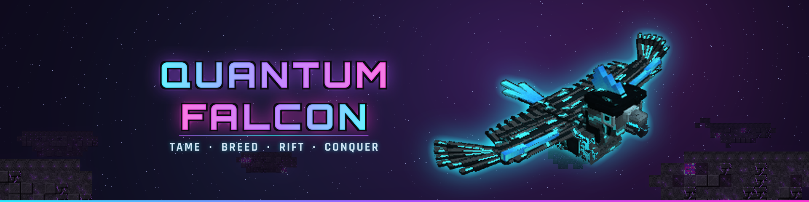

# Quantum Falcon (Java Edition)

A NeoForge 1.21.1 mod: tame and breed quantum falcons, cross into the Echo Rift, fight its bosses, clear warded
dungeons and level use-based skills.

## Editions
- **Java** (this repository): NeoForge 1.21.1. Requires GeckoLib and Custom Portal API Reforged.
- **Bedrock** (coming after 1.0): a separate behaviour/resource-pack port, planned in its own repository
  (see its `PORTING_PLAN.md`).

Report bugs with the matching issue template: **Bug report (Java)** or **Bug report (Bedrock)**. For security issues see
`SECURITY.md`.

## Links
- Discord: *link coming soon*
- CurseForge: *page coming soon*
- Modrinth: *page coming soon*

## Building
Needs JDK 21. `./gradlew build` makes the mod jar (without the `/qftest` harness); `./gradlew build -PqfTestJar` keeps
the test commands for server-side testing.

## Licence
**All Rights Reserved.** Copyright (c) 2026 Matthew Hampton. The source is public for reference only: no copying,
modification, redistribution or reuse. You **may** include the unmodified jar in CurseForge and Modrinth modpacks
(through the platforms), and make videos, streams and screenshots. Third-party
credits are in `CREDITS.md` and keep their own licences. Full text: `LICENSE`.
